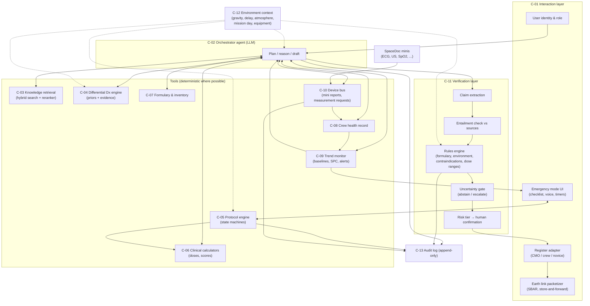
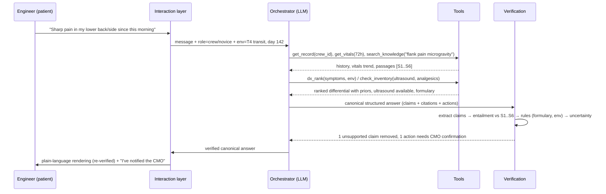
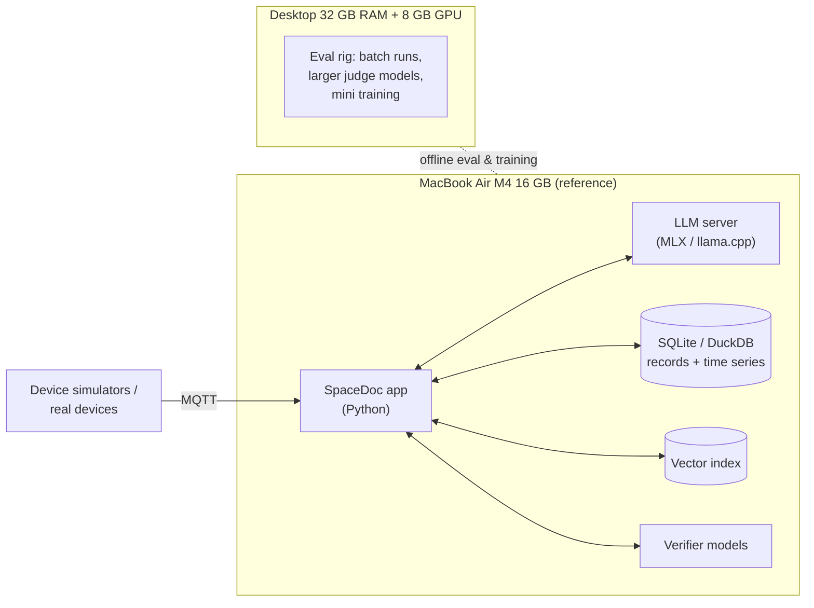

# 01 — System Architecture

## 1. Core principle: split *language* from *truth*

LLMs are excellent at understanding messy questions, reasoning over context, and explaining things at the right level. They are **not** reliable stores of facts or calculators. SpaceDoc therefore divides the work like this:

| Job | Done by | Why |
|---|---|---|
| Understand the user, plan, reason, write | LLM (orchestrator) | Flexible language ability |
| Medical facts | Retrieval from a curated, versioned knowledge base | Citable, updatable, auditable |
| Doses, scores, unit conversions, thresholds | Deterministic code and validated tables | Exact and testable (SR-02) |
| What's aboard, what's expired | Inventory database | Ground truth (SR-03) |
| Patient facts | Crew health record | Ground truth (SR-01) |
| Emergency steps | Pre-validated protocol state machines | Predictable under time pressure (SR-06) |
| Signal interpretation | SpaceDoc minis (specialized neural nets) | Faster and more accurate than a general LLM on raw signals |
| "Is this answer supported?" | Verification layer (separate models plus rules) | Independent check (SR-01, SR-04) |

## 2. Component view

### Component responsibilities and traceability

| ID | Component | Responsibilities | Requirements |
|---|---|---|---|
| C-01 | Interaction layer | Authentication, role profile, register adaptation, emergency UI, voice, Earth packets | FR-09, FR-10, FR-14, SR-09, SR-12 |
| C-02 | Orchestrator agent | Understand intent, plan tool calls, draft structured answers | FR-01–04, FR-13 |
| C-03 | Knowledge retrieval | Hybrid keyword and vector search, reranking, environment-tag filtering, citation IDs | FR-01, SR-01 |
| C-04 | Differential Dx engine | Condition list (seeded from NASA's 100-condition Exploration Medical Condition List [[R7](references.md#r7)] and the high-likelihood or high-consequence conditions in NASA-STD-3001 Vol 1, Table E.2-2 [[R5](references.md#r5)]), base rates by environment, evidence scoring, feasible discriminating tests | FR-03, SR-03 |
| C-05 | Protocol engine | Deterministic emergency and procedure checklists with branching and timers | FR-05, SR-06, NFR-02 |
| C-06 | Clinical calculators | Dosing (weight, renal), fluids, scores (e.g. GCS, qSOFA), unit conversions | SR-02 |
| C-07 | Formulary & inventory | Onboard items, quantities, expiry, substitutions | FR-04, FR-11, SR-03 |
| C-08 | Crew health record | Encounters, observations (with provenance), meds, baselines | FR-07, FR-12 |
| C-09 | Trend monitor | Per-person baselines, drift/changepoint detection, tiered alerts | FR-08 |
| C-10 | Device bus | Receives mini reports; requests measurements; stores raw-data references | FR-06, SR-07 |
| C-11 | Verification layer | Claim-level grounding, rules, uncertainty, risk-tiered confirmation | SR-01–05, SR-09, SR-11 |
| C-12 | Environment context | Single source of truth for the mission state | SR-03, all reasoning |
| C-13 | Audit log | Append-only, hash-chained record of everything | SR-08 |

## 3. Three operating modes

| Mode | Trigger | Critical path | LLM role |
|---|---|---|---|
| **Consult** | User question or symptom report | Orchestrator → tools → verification → adapter | Primary reasoner, fully verified |
| **Emergency** | Keyword ("not breathing"), device alarm, or CMO button | Protocol engine → emergency UI | Off the critical path. Can answer side questions ("what does this step mean?") with verified output |
| **Background** | Continuous | Minis → device bus → record → trend monitor → alerts | Only summarizes alerts when someone asks |

This split satisfies SR-10: if the LLM crashes, emergency and monitoring keep running.

## 4. Life of a consult query

The orchestrator first produces a **canonical structured answer**: JSON with claims, each claim's citation IDs, proposed actions, and uncertainty. Only after verification is it **rendered** into prose for the specific user (see [07](07-adaptive-interaction.md)). Separating content from presentation is what makes both verification and role adaptation tractable.

## 5. Deployment view (prototype)

The laptop runs the system. The desktop trains minis and runs large overnight evaluation batches. Details are in [02](02-local-inference.md).

## 6. Technology choices (proposed, to be confirmed in Phase 1)

| Concern | Proposal | Rationale |
|---|---|---|
| Language | Python | Dominant ML ecosystem |
| LLM serving | `mlx-lm` or llama.cpp / Ollama (OpenAI-compatible local API) | Mature on Apple Silicon; swappable backend |
| Agent loop | A small hand-written loop plus structured outputs, before any framework | Easier to learn, audit and verify; add a framework only if needed |
| Structured output | JSON schema-constrained decoding (llama.cpp grammars, MLX / Outlines-style) | Guarantees parseable canonical answers |
| Retrieval | SQLite FTS5 (keyword) + vector index + local reranker | Hybrid beats either alone on medical terminology |
| Records | FHIR-inspired schema in SQLite; time series in DuckDB/Parquet | Zero-ops, portable, file-based |
| Device bus | MQTT (e.g. Mosquitto) | Lightweight publish/subscribe standard used in IoT |
| Protocols | Declarative YAML state machines + interpreter | Clinicians can review them; deterministic |
| Packaging | Containers (Podman/Docker) | Reproducibility; revisit container-based deployment for the analog phase |

---

## How this works in AI systems: tools and structured output

An LLM "calls a tool" by emitting a specially formatted piece of text, usually JSON such as `{"tool": "get_vitals", "args": {"crew_id": "C3", "hours": 72}}`. Your code watches for it, runs the real function, and pastes the result back into the conversation. The model never touches the database directly; your code does, and it can refuse.

**Structured output** (constrained decoding) goes further. At each generation step the runtime masks out any next token that would break a JSON schema you supply. It works like a mechanical keyed connector: the model physically cannot produce a malformed answer. SpaceDoc uses this to force every answer into the canonical form `{claims:[{text, citations}], actions:[...], uncertainty}`, which the verification layer can then check item by item.
