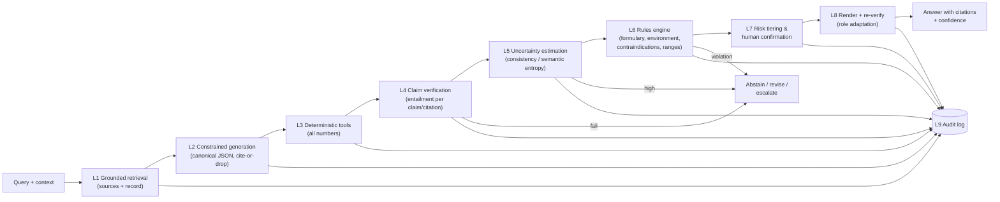

# 03 — Hallucination Prevention Layer

> No single technique eliminates hallucination. SpaceDoc uses **defense in depth**: several independent layers, each catching failures the others miss. This is the Swiss-cheese model from safety engineering, where each slice has holes but the holes rarely line up.

## 1. What can go wrong: a failure taxonomy

"Hallucination" covers several distinct failure modes. Each one needs a different defense.

| # | Failure mode | Example | Primary defenses |
|---|---|---|---|
| H1 | **Fabricated fact** | Invents a drug interaction or guideline | L1 grounding, L4 entailment |
| H2 | **Unsupported extrapolation** | A real source says X; the model claims X also applies to Y | L4 entailment, L5 uncertainty |
| H3 | **Numeric error** | Wrong dose, wrong unit, wrong threshold | L3 deterministic tools, L6 rules |
| H4 | **Context/environment error** | Recommends orthostatic vitals in microgravity, or a drug not aboard | L6 rules (environment and formulary) |
| H5 | **Patient-data error** | Misreads the record ("no allergies" when there is one) or invents a vital sign | L1 record grounding, L4 check against record |
| H6 | **Omission** | Misses a critical action or red flag (hallucination by absence) | L7 checklists, differential engine, eval critical-action recall |
| H7 | **Sycophancy** | Agrees with a user's wrong self-diagnosis | Prompting, L5 uncertainty, red-team tests |
| H8 | **Fabricated citation** | Cites a source that doesn't say that | L4 per-citation entailment |
| H9 | **Rendering drift** | Simplifying for a novice changes the meaning ("take 2" becomes "take some") | L8 re-verification of rendered text |
| H10 | **Device-model error** | A mini misclassifies a noisy or out-of-distribution signal | Mini contract (SQI, OOD, calibration), cross-checks |
| H11 | **Injected instructions** | A document or device note contains "ignore previous instructions" | Data/instruction separation, L6 |

## 2. The layers

### L1 — Grounded retrieval

- The orchestrator answers **from retrieved passages and the patient record**, not from its training memory. Retrieval is hybrid (keyword + semantic) with a reranker and **environment tags** ([04](04-knowledge-and-training.md)).
- Each passage gets a stable ID (`S3`, `R7` for record items), which the model must cite.
- If retrieval returns nothing relevant, that fact is passed explicitly to the model ("No sources found on X"), which primes it to abstain.

### L2 — Constrained generation ("cite or drop")

- Output is forced into the canonical schema: a list of atomic claims, each with citation IDs, plus proposed actions and self-reported uncertainty.
- **A claim without a citation is dropped**, or shown only with an explicit marker such as "general reasoning, not from a source", depending on its risk tier.
- The prompt instructs the model to say "insufficient information" rather than guess, and gives it an easy way to do so.

### L3 — Deterministic tools for anything numeric

Doses, infusion rates, scores, unit conversions and reference ranges are all tool calls to tested code and validated tables. The LLM may *choose* which calculator to call and *explain* its result. It never produces the number itself (SR-02). Verification (L6) confirms that every number in the final answer matches a tool output exactly.

### L4 — Claim-level verification (the core check)

For each claim–citation pair, a separate **entailment model** asks: *"Does passage S3 actually support this sentence?"* Candidates:

- **MiniCheck** (0.77B, Flan-T5): a purpose-built grounding checker. On the LLM-AggreFact benchmark it reached a balanced accuracy of 74.7%, against 75.3% for GPT-4, at more than 400 times lower cost [[R17](references.md#r17)]. It gives a binary verdict (supported or unsupported) and was tested in English only.
- An NLI (natural language inference) model as a cross-check. This is also where a `contradicted` verdict comes from, since MiniCheck does not separate "unsupported" from "contradicted".
- For flagged or high-risk claims, a second pass by the LLM itself in the style of **Chain-of-Verification** (CoVe): generate open verification questions, answer each one separately without showing the model its draft, then compare [[R19](references.md#r19)]. In the CoVe paper the model answers from its own memory; answering from the retrieved sources is SpaceDoc's adaptation (the authors name retrieval as a natural extension). Use open questions: the paper found that yes/no questions invite the model to agree with itself.

Outcome per claim: `supported` / `unsupported` / `contradicted`. A contradicted claim triggers a revision. An unsupported high-risk claim is removed, and the answer states the gap.

### L5 — Uncertainty estimation

Even supported answers can be fragile. Techniques, in order of cost:

1. **Retrieval confidence:** reranker scores, source agreement.
2. **Self-consistency:** sample the answer several times. If the differential rankings or recommended actions disagree, confidence is low.
3. **Semantic entropy** [[R16](references.md#r16)]: cluster sampled answers by *meaning*, not wording. High entropy across meanings signals a likely confabulation. Two caveats: it detects *arbitrary* errors (answers that change from sample to sample), not errors the model makes consistently, and the paper tested it without retrieved passages in the prompt.
4. **Conformal prediction** for the differential diagnosis: calibrate on the SpaceOSCE case bank so the system outputs a *set* of diagnoses with a target coverage (e.g. the true diagnosis is in the set ≥ 90% of the time), and abstains when the set is too large to be useful [[R21](references.md#r21)]. The coverage guarantee holds only when calibration cases resemble the cases seen in use (exchangeability). In the paper, calibrating on one subject and testing on another dropped coverage to about 83% against a 90% target, and the method was shown for multiple-choice answers, not free text. The calibration set must therefore match the mission's case mix.

High uncertainty leads to abstention, with specific next steps: "I can't distinguish A from B. An ultrasound of the right kidney would help. Want the guided protocol?"

### L6 — Rules engine (hard constraints)

Deterministic checks written and reviewed with clinicians:

- **Formulary/inventory:** every drug or device mentioned is aboard, in date, and in sufficient quantity. Otherwise it is flagged and substitutes are suggested.
- **Environment feasibility:** a table of procedures and exam maneuvers × gravity tier (e.g. positional tests, fluid levels, standard CPR positioning in 0 g). See [04 §4](04-knowledge-and-training.md#4-the-aerospace-context-model).
- **Contraindications and interactions** against the patient's record (allergies, current meds).
- **Range checks:** doses within validated min/max for the drug and patient.
- **Consistency with record:** any patient fact in the answer must match the record.
- **Injection guard:** instructions found inside retrieved content are ignored and logged.

### L7 — Risk tiering and human confirmation

| Tier | Examples | Handling |
|---|---|---|
| R0 Informational | "What is SANS?" | Verified answer |
| R1 Advisory | Self-care, hydration, OTC-type meds | Verified answer + record entry |
| R2 Clinical action | Prescription meds, diagnostic procedures | Requires CMO confirmation |
| R3 High-risk | Invasive procedures, high-alert meds, sedation | CMO confirmation + second-crew read-back + Earth packet if the link allows |
| R4 Emergency | Arrest, anaphylaxis, airway | Deterministic protocol only (SR-06) |

### L8 — Render and re-verify

After verification, the canonical answer is rendered for the user's role ([07](07-adaptive-interaction.md)). The rendered text is **checked again** against the canonical answer: an entailment check in both directions, plus an exact match on numbers, drug names and units. This catches H9 rendering drift.

### L9 — Audit trail

Every retrieval, tool call, model version, verifier verdict and final output is logged (SR-08). This supports after-action review, debugging, and the evidence a safety case needs.

## 3. Measuring the layer itself

A hallucination layer we can't measure is just a hope. Metrics (details in [08](08-validation-framework.md)):

| Metric | Definition |
|---|---|
| Claim support rate | % of displayed atomic claims supported by their citations (human-audited sample), in the style of FActScore [[R20](references.md#r20)]. Report it together with the abstention rate, since abstaining raises precision |
| Citation precision | % of citations that actually support their claim. Having a citation is not the same as being supported: in the FActScore study, a search-backed system's supported and unsupported sentences carried citations at almost the same rate (36.0% vs 37.6%) [[R20](references.md#r20)] |
| Unsupported-claim escape rate | Unsupported claims that reached the user ÷ all unsupported claims generated |
| Verifier accuracy | MiniCheck/NLI accuracy on a SpaceDoc-specific labeled set, and on MedHallu for reference |
| Numeric integrity | % of numbers in outputs that trace to a tool output (target 100%) |
| Environment violation rate | Infeasible recommendations reaching the user (target 0) |
| Abstention quality | Precision and recall of abstentions against cases that *should* be abstained |

**Known limits.** Detection is imperfect. On MedHallu's "hard" category, the best LLM detector reached an F1 of only ~0.63 when it was not given the source text; with the source text it reached ~0.81 [[R18](references.md#r18)]. This is one more reason to verify against retrieved passages rather than the model's memory. Verification models share blind spots with the models they check. Retrieval can surface an outdated source. That is why the layers are independent and diverse, why numbers and emergencies bypass the LLM entirely, and why a human stays in the loop for anything consequential.

---

## How this works in AI systems: why LLMs hallucinate

An LLM is trained to produce the **most plausible continuation** of text. "Plausible" and "true" usually coincide, but not always. The model has no built-in signal that separates "I know this" from "this sounds like things I've seen". Asked about a rare drug interaction, it produces text *shaped like* an answer whether or not it has reliable knowledge.

Engineering parallels:
- **Redundant sensors with voting:** self-consistency and semantic entropy are like reading the same quantity several times. If the readings scatter, you don't trust any of them.
- **Independent verification:** the entailment checker is a separate instrument checking the first one's reading against a reference standard (the source text).
- **Interlocks:** the rules engine is a hardware interlock. It doesn't matter how confident the controller is; if the drug isn't aboard, the command is blocked.
- **Fail-safe defaults:** abstention is the safe state. The system is designed so that "I don't know, here's what would help" is always an easy, acceptable output.
