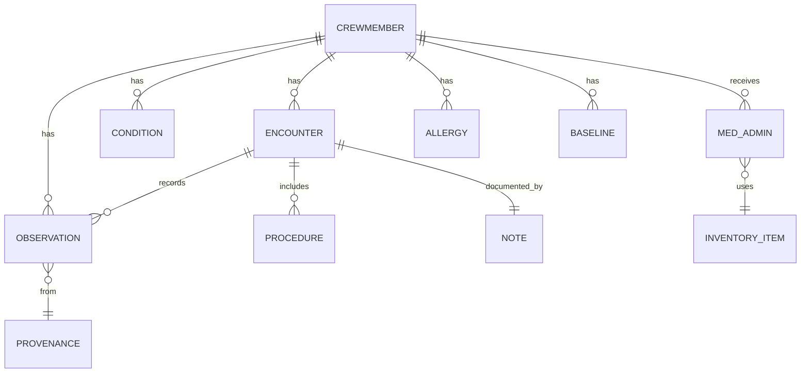
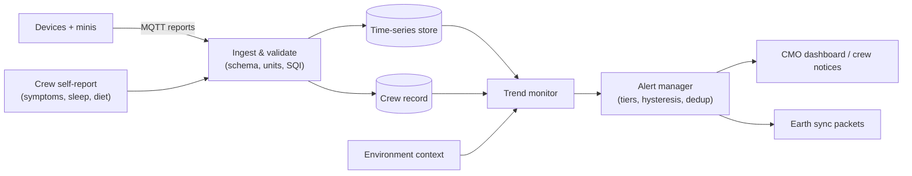

# 06 — Crew Health Records & Long-Term Monitoring

## 1. Crew Health Record (C-08)

A FHIR-inspired data model keeps records interoperable with terrestrial EHRs (NFR-08) without the full complexity of FHIR in the prototype.

| Entity | Key fields |
|---|---|
| **Observation** | code (LOINC where possible), value, unit, time, **provenance** (device + mini version / manual entry / crew-reported), quality score, environment snapshot (gravity, mission day) |
| **Baseline** | For each measure: preflight mean/variance, in-flight adapted baseline, expected trajectory model (see §3) |
| **Condition** | Status (suspected / confirmed / resolved), onset, evidence links, who confirmed |
| **MedAdmin** | Drug, dose (from calculator), route, time, lot/expiry, authorizer, administered-by |
| **Note** | Drafted by SpaceDoc, **signed by the CMO** (FR-12). Unsigned notes are marked as drafts |

**Rules:**
- Records are append-only. Corrections create new versions and never overwrite.
- Every AI-drafted item is labeled as such until a human confirms it.

These rules follow NASA-STD-3001 Vol 1, which requires that crew health monitoring results are kept in a permanent, retrievable format that supports trend analysis, and that medical records are handled, stored and transmitted securely [[R5](references.md#r5)].

## 2. Data flow

## 3. Trend monitoring (C-09): per-person, context-aware

Population "normal ranges" are a poor fit for astronauts:
- They are a highly screened, fit population.
- Spaceflight shifts many values in *expected* ways: fluid redistribution, body mass loss, heart rate and blood pressure changes, bone markers.

SpaceDoc therefore monitors each person against **their own baseline, adjusted for expected spaceflight trajectories**.

### Methods, from simple to advanced

| Method | What it catches | Use |
|---|---|---|
| **Hard limits** | Dangerous absolute values (SpO2 < threshold, HR > threshold) | Always on. Deterministic and immediate |
| **EWMA / CUSUM control charts** | Slow drifts and small persistent shifts relative to personal baseline | Core long-term method: transparent and well understood |
| **Changepoint detection** (e.g. PELT, Bayesian online changepoint) | "Something changed around day 118" | Retrospective and online review |
| **Expected-trajectory residuals** | Deviation from *expected* adaptation (e.g. body mass trend) | Removes false alarms from normal adaptation |
| **Multivariate anomaly** (Mahalanobis distance, isolation forest, later autoencoders) | Unusual *combinations* (HR ↑ + HRV ↓ + sleep ↓ + temp ↑) | Phase 2+; needs more data |
| **Cross-crew comparison** | Shared exposure (a CO2 excursion, contamination, dust) | The whole crew drifting together suggests an environmental cause |

### Long-term watch list (clinician review required)

- Vision and ocular changes (SANS): visual acuity checks, fundus/OCT via minis
- Cardiovascular: resting HR, BP, HRV, arrhythmia burden
- Body mass, hydration and urine indicators (renal stone risk)
- Sleep quantity and quality, workload, mood check-ins
- Cumulative radiation dose per crewmember
- Exercise countermeasure adherence versus musculoskeletal indicators
- Surface missions: respiratory symptoms and spirometry after dust exposure; thyroid markers (Mars perchlorate) where lab capability exists

## 4. Alerting without alert fatigue

The alert tiers borrow the spacecraft caution & warning convention, which is familiar to crews. NASA-STD-3001 Vol 2 defines emergency, warning, caution and advisory alerts with distinct visual and audio annunciation, and reserves red for emergency and warning, yellow for caution and blue for advisory [[R6](references.md#r6)]. Stale or missing data must be marked as such (cyan in the Vol 2 display standard):

| Tier | Meaning | Delivery |
|---|---|---|
| **Warning** | Immediate threat; act now | Audible and visual; opens emergency mode if matched to a protocol |
| **Caution** | Needs attention within hours | CMO notification |
| **Advisory** | Trend worth reviewing | Daily medical digest |
| **Info** | Logged | Record only |

**Fatigue controls:**
- hysteresis (separate raise and clear thresholds)
- persistence requirements (condition must hold N samples)
- deduplication and grouping
- SQI gating (no alerts from bad signals)
- snooze with reason, which is logged
- weekly review of alert precision

A monitor that cries wolf gets ignored, which is its own safety hazard. Vol 2 also requires that crew can silence, suppress and inhibit alerts, and that the system reminds them which alerts are inhibited [[R6](references.md#r6)].

## 5. Privacy and access (SR-12)

| Role | Access |
|---|---|
| Crewmember | Own full record |
| CMO | All crew records |
| Commander | Fitness-for-duty status and mission-impact summaries only |
| Earth flight surgeon | Full records through sync (per mission medical policy) |
| Other crew | Nothing, unless acting under CMO direction in an emergency (time-limited, logged) |

NASA-STD-3001 requires private two-way medical communication with the ground and private transmission of medical data [[R5](references.md#r5)], and protection of sensitive and private data in the information system [[R6](references.md#r6)].

## 6. Earth synchronization (delay-tolerant)

- **Packets:** SBAR summary + deltas since last sync + referenced raw data prioritized by relevance. Everything is compressed, checksummed and versioned.
- **Replies:** Earth replies (advice, updated protocols, KB updates) are ingested as **tier A** sources. They are clearly attributed and time-stamped with the delay ("advice based on data as of 47 minutes ago").
- **Blackout:** during conjunction, packets queue with priorities and SpaceDoc runs fully autonomous.

---

## How this works in AI systems: base rates and why alarms mislead

Suppose a detector is 95% sensitive and 95% specific, and the condition it detects occurs in 1 of 1,000 checks. Out of 1,000 checks it catches the ~1 real case, but it also raises ~50 false alarms. **Positive predictive value ≈ 2%.** This is the base-rate problem. It is why SpaceDoc:

- **Uses personal baselines.** They reduce variance, so thresholds can be tighter without extra false alarms.
- **Requires persistence and good signal quality.** This raises effective specificity.
- **Combines signals.** Independent weak evidence multiplies, as in a Bayesian update.
- **Measures alert precision in operation**, not just detector accuracy on a test set.

Control charts (EWMA, CUSUM) will be familiar from manufacturing statistical process control. A crewmember's resting heart rate is a "process". The baseline is the in-control state, and the chart detects a sustained shift long before any single reading looks abnormal.
